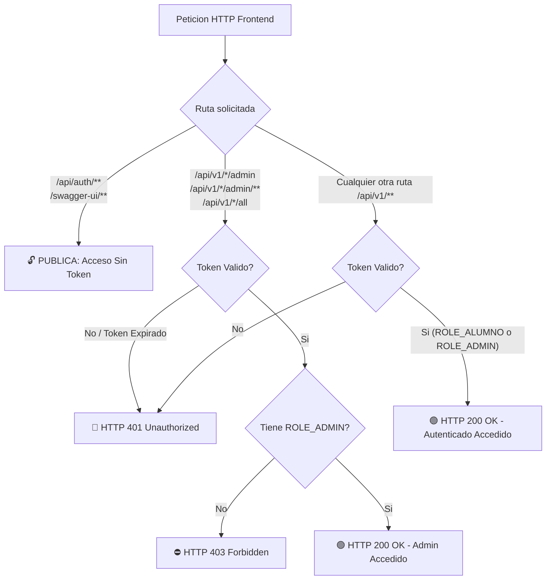

# 🔐 Guía Completa de Seguridad y Autenticación JWT para Frontend - Arrupeteca

Esta guía está diseñada para desarrolladores de Frontend y agentes de IA que necesiten integrar la autenticación, autorización y consumo de la API de **Arrupeteca**.

---

## 📌 1. Visión General de la Arquitectura de Seguridad

- **Mecanismo de Autenticación**: JSON Web Token (JWT) basado en el esquema `Bearer`.
- **Estado de la Sesión**: *Stateless* (sin estado en servidor; el estado del usuario vive en el token).
- **Algoritmo de Firma**: HMAC SHA-256 (`HS256`).
- **Encabezado HTTP**:
  ```http
  Authorization: Bearer <token_jwt_aqui>
  ```
- **Duración del Token**: 24 horas (86,400,000 milisegundos).
- **CORS Configurado para Desarrollo**:
  - Origen permitido por defecto: `http://localhost:5173` (Vite / React / Vue / Svelte standard).
  - Métodos permitidos: `GET`, `POST`, `PUT`, `DELETE`, `PATCH`, `OPTIONS`.
  - Encabezados permitidos: `Authorization`, `Content-Type`, `X-Requested-With`, `Accept`.

---

## 🔑 2. Credenciales por Defecto (Seed Users para Pruebas)

Puedes usar estos usuarios precreados en el entorno de desarrollo para probar los flujos de autenticación y permisos en el Frontend:

| Rol | Correo Electrónico | Contraseña | Carnet | Rol Asignado (`authorities`) |
| :--- | :--- | :--- | :--- | :--- |
| **Administrador** | `admin@arrupeteca.com` | `Password123!` | `ADM-0001` | `ROLE_ADMIN` |
| **Alumno** | `alumno@arrupeteca.com` | `Password123!` | `ALU-2026-001` | `ROLE_ALUMNO` |

---

## 🚀 3. Endpoints de Autenticación (`/api/auth`)

Los endpoints de autenticación son **públicos** (no requieren token previo).

### 3.1. Iniciar Sesión (`POST /api/auth/login`)

Autentica las credenciales de un usuario existente y devuelve el token de acceso.

#### 📩 Solicitud (Request Body)
- **Content-Type**: `application/json`

```json
{
  "correo": "admin@arrupeteca.com",
  "contrasena": "Password123!"
}
```

#### 📋 Especificación de Campos Request:
| Campo | Tipo | Obligatorio | Reglas de Validación |
| :--- | :--- | :---: | :--- |
| `correo` | `String` | Sí | Formato de correo válido. Se aplica `trim()` y `toLowerCase()`. |
| `contrasena` | `String` | Sí | Texto plano de la contraseña. |

#### 📤 Respuesta Exitosa (`HTTP 200 OK`)
```json
{
  "exito": true,
  "mensaje": "Autenticación exitosa",
  "data": {
    "token": "eyJhbGciOiJIUzI1NiJ9.eyJzdWIiOiJhZG1pbkB... ",
    "tipo": "administrador",
    "correo": "admin@arrupeteca.com",
    "nombreCompleto": "Administrador Principal"
  }
}
```

---

### 3.2. Registrar Nuevo Usuario (`POST /api/auth/register`)

Registra un nuevo usuario en el sistema. **Por regla de negocio, todo usuario registrado por este endpoint recibe automáticamente el rol de `alumno` (`ROLE_ALUMNO`)**.

#### 📩 Solicitud (Request Body)
- **Content-Type**: `application/json`

```json
{
  "nombres": "Juan Carlos",
  "apellidos": "Pérez Gómez",
  "correo": "juan.perez@arrupeteca.com",
  "contrasena": "Password123!",
  "carnet": "ALU-2026-099"
}
```

#### 📋 Especificación de Campos Request:
| Campo | Tipo | Obligatorio | Reglas de Validación |
| :--- | :--- | :---: | :--- |
| `nombres` | `String` | Sí | Máximo 100 caracteres. No puede estar vacío. |
| `apellidos` | `String` | Sí | Máximo 100 caracteres. No puede estar vacío. |
| `correo` | `String` | Sí | Máximo 150 caracteres. Formato de correo válido. Único en el sistema. |
| `contrasena` | `String` | Sí | Mínimo 6 caracteres, máximo 100 caracteres. |
| `carnet` | `String` | No | Máximo 20 caracteres. Opcional. |
| `idTipo` | `Long` | No | Opcional. Si se omite o es `null`, el backend asigna automáticamente el tipo `alumno` (ID 2). |

#### 📤 Respuesta Exitosa (`HTTP 201 Created`)
```json
{
  "exito": true,
  "mensaje": "Usuario registrado exitosamente",
  "data": {
    "token": "eyJhbGciOiJIUzI1NiJ9.eyJzdWIiOiJqdWFuLnBlcmV6Q... ",
    "tipo": "alumno",
    "correo": "juan.perez@arrupeteca.com",
    "nombreCompleto": "Juan Carlos Pérez Gómez"
  }
}
```

---

## 🔍 4. Estructura y Contenido del Token JWT (Payload)

El token JWT devuelto en la propiedad `data.token` consta de 3 secciones separadas por puntos (`Header.Payload.Signature`).

### 📦 Payload (Claims decodificado)

Si decodificas la sección central (Payload) en Base64URL en el Frontend, encontrarás los siguientes datos:

```json
{
  "sub": "admin@arrupeteca.com",
  "iss": "ArrupetecaAPI",
  "iat": 1773189000,
  "exp": 1773275400,
  "authorities": [
    "ROLE_ADMIN"
  ]
}
```

### 📋 Descripción de los Claims:
| Claim | Tipo | Descripción | Uso Recomendado en Frontend |
| :--- | :--- | :--- | :--- |
| `sub` | `String` | Correo electrónico del usuario (identificador principal). | Mostrar correo en perfil o barra de navegación. |
| `authorities` | `List<String>` | Lista de roles asignados en Spring Security (ej. `["ROLE_ADMIN"]` o `["ROLE_ALUMNO"]`). | **Controlar visibilidad de botones, menús o rutas del router en Frontend**. |
| `iss` | `String` | Emisor del token (`ArrupetecaAPI`). | Validación de procedencia. |
| `iat` | `Long` | Timestamp (Unix epoch en segundos) de la fecha/hora de emisión. | Auditoría. |
| `exp` | `Long` | Timestamp (Unix epoch en segundos) de la fecha/hora de expiración. | **Determinar si el token ha expirado antes de hacer una petición**. |

---

## 🛡️ 5. Matriz de Control de Acceso y Rutas (RBAC)

El servidor clasifica las rutas en 3 niveles de acceso:



### 📊 Resumen de Permisos por Endpoint:

| Patrón de Ruta | Métodos HTTP | Nivel de Protección | Rol Requerido |
| :--- | :---: | :---: | :--- |
| `/api/auth/login` | `POST` | **Público** | Ninguno |
| `/api/auth/register` | `POST` | **Público** | Ninguno |
| `/swagger-ui/**`, `/v3/api-docs/**` | `GET` | **Público** | Ninguno |
| `/actuator/health` | `GET` | **Público** | Ninguno |
| `/api/v1/*/admin` | Todos | **Administrador** | **`ROLE_ADMIN`** |
| `/api/v1/*/admin/**` | Todos | **Administrador** | **`ROLE_ADMIN`** |
| `/api/v1/*/all` | Todos | **Administrador** | **`ROLE_ADMIN`** |
| `/api/v1/obras/**` (no admin) | `GET`, `POST`, etc. | **Autenticado** | `ROLE_ALUMNO` o `ROLE_ADMIN` |
| `/api/v1/libros/**` (no admin) | `GET`, `POST`, etc. | **Autenticado** | `ROLE_ALUMNO` o `ROLE_ADMIN` |
| `/api/v1/ejemplares/**` (no admin) | `GET`, `POST`, etc. | **Autenticado** | `ROLE_ALUMNO` o `ROLE_ADMIN` |

---

## ❌ 6. Manejo de Errores y Respuestas HTTP

Todas las respuestas del sistema siguen la estructura unificada `ApiResponse<T>`.

### 6.1. Error de Credenciales Incorrectas (`HTTP 400 Bad Request` o `HTTP 401 Unauthorized`)
```json
{
  "exito": false,
  "mensaje": "Bad credentials",
  "data": null
}
```

### 6.2. Error de Validación de Campos (`HTTP 400 Bad Request`)
Ocurre cuando falta un campo obligatorio o no cumple el formato (ej. correo inválido o contraseña corta).
```json
{
  "exito": false,
  "mensaje": "El correo es obligatorio, La contraseña debe tener entre 6 y 100 caracteres",
  "data": null
}
```

### 6.3. Error de Usuario o Correo Duplicado (`HTTP 400 Bad Request`)
```json
{
  "exito": false,
  "mensaje": "Ya existe un usuario registrado con el correo: juan.perez@arrupeteca.com",
  "data": null
}
```

### 6.4. Token Ausente o Inválido (`HTTP 401 Unauthorized`)
Ocurre cuando se intenta acceder a una ruta protegida sin el encabezado `Authorization: Bearer <token>` o con un token alterado/expirado.
```json
{
  "exito": false,
  "mensaje": "Acceso denegado: Token JWT ausente, expirado o inválido",
  "data": null
}
```

### 6.5. Acceso Denegado por Falta de Rol (`HTTP 403 Forbidden`)
Ocurre cuando un usuario con rol `ROLE_ALUMNO` intenta acceder a una ruta restringida a administradores como `/api/v1/categorias/admin`.
```json
{
  "exito": false,
  "mensaje": "Acceso denegado: No posee los permisos o rol requeridos para esta operación",
  "data": null
}
```

---

## 💻 7. Ejemplo Práctico de Implementación en Frontend (TypeScript / Axios)

A continuación se presenta un patrón recomendado para configurar **Axios** en una aplicación de Frontend (React / Vue / Angular / Svelte):

```typescript
import axios from 'axios';

// 1. Crear instancia base de Axios
const api = axios.create({
  baseURL: 'http://localhost:8080', // O URL del servidor backend
  headers: {
    'Content-Type': 'application/json',
  },
});

// 2. Interceptor de Solicitudes: Adjunta automáticamente el token JWT
api.interceptors.request.use((config) => {
  const token = localStorage.getItem('jwt_token');
  if (token) {
    config.headers.Authorization = `Bearer ${token}`;
  }
  return config;
}, (error) => Promise.reject(error));

// 3. Interceptor de Respuestas: Maneja expiración de sesión (401) y permisos denegados (403)
api.interceptors.response.use(
  (response) => response.data,
  (error) => {
    if (error.response) {
      const status = error.response.status;
      if (status === 401) {
        console.warn('Sesión expirada o token inválido. Redirigiendo a login...');
        localStorage.removeItem('jwt_token');
        window.location.href = '/login';
      } else if (status === 403) {
        console.error('No tienes permisos de Administrador para realizar esta acción.');
      }
    }
    return Promise.reject(error.response?.data || error.message);
  }
);

export default api;
```

---

## 📝 8. Checklist de Integración para Agentes / Desarrolladores Frontend

- [ ] Al iniciar sesión exitosamente (`POST /api/auth/login`), guardar el token devuelto (`data.token`) en `localStorage` o memoria de la app.
- [ ] En cada petición HTTP enviada a rutas bajo `/api/v1/**`, incluir la cabecera `Authorization: Bearer ${token}`.
- [ ] Para determinar los permisos del usuario en la interfaz (ocultar/mostrar botones de Admin):
  - Decodificar los `authorities` del JWT o verificar la propiedad `data.tipo` recibida al hacer login (`administrador` vs `alumno`).
- [ ] Si la API responde con un status `401 Unauthorized`, limpiar el token almacenado y redirigir al formulario de inicio de sesión.
- [ ] Recordar que la registración pública (`POST /api/auth/register`) **siempre** asigna el rol `alumno` por defecto. Si se requiere crear otro administrador, debe hacerse directamente en base de datos o desde el panel de administración.
