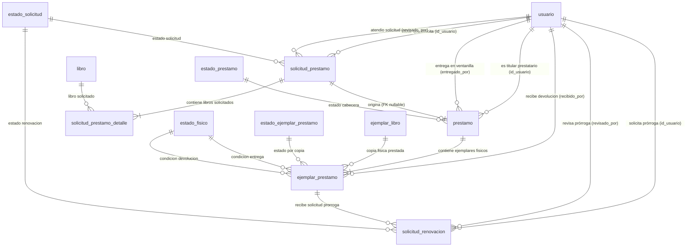

# Especificación y Diseño del Módulo de Préstamos — Arrupeteca

Documento técnico de diseño de base de datos, reglas de negocio y estándares arquitectónicos para el **Módulo de Préstamos** del sistema **Arrupeteca**.

---

## 1. Reglas de Arquitectura y Estándares del Proyecto

Para mantener coherencia estricta con el código ya implementado en Arrupeteca (`Autor`, `Libro`, `ObraAutor`, `EjemplarLibro`), este módulo respeta los siguientes principios:

### A. Claves Primarias y Restricciones (Patrón `ObraAutor`)
- **No utilizar claves primarias compuestas** (`@EmbeddedId` / `@IdClass`).
- Cada tabla, incluidas las de detalle (`ejemplar_prestamo`, `solicitud_prestamo_detalle`), tiene su propio identificador único simple:
  ```java
  @Id
  @GeneratedValue(strategy = GenerationType.IDENTITY)
  private Long id;
  ```
- Si se necesita evitar duplicidad física (por ejemplo, que el mismo ejemplar no se duplique en un mismo préstamo activo), se utiliza una restricción de unicidad a nivel de tabla:
  ```java
  @Table(name = "ejemplar_prestamo", uniqueConstraints = {
      @UniqueConstraint(name = "uk_prestamo_ejemplar", columnNames = {"id_prestamo", "id_ejemplar_libro"})
  })
  ```

### B. Soft Delete (Borrado Lógico)
- Toda tabla transaccional y catálogo contiene la columna `borrado_logico TINYINT NOT NULL DEFAULT 0`.
- En JPA se anota con:
  ```java
  @SQLDelete(sql = "UPDATE nombre_tabla SET borrado_logico = 1 WHERE id = ?")
  ```

### C. Auditoría Automática
- Las entidades transaccionales principales heredan de `Auditable`:
  - `fecha_creacion DATETIME NOT NULL`
  - `fecha_actualizacion DATETIME NOT NULL`
  - `creado_por VARCHAR(100) NOT NULL`

### D. Concurrencia Optimista
- Las tablas con alta concurrencia transaccional (`ejemplar_prestamo`) incluyen `@Version Long version` para evitar colisiones al procesar préstamos y devoluciones concurrentes.

### E. DTOs y Mappers
- DTOs modelados mediante **Java Records inmutables** organizados en:
  - `dto.request` (con validaciones `@NotNull`, `@Size`, etc.).
  - `dto.response.detail` (detalle completo para admin y usuario).
  - `dto.response.summary` (proyecciones paginadas para listados y tablas).
- Mapeo bidireccional mediante **MapStruct** (`CentralMapperConfig`).

---

## 2. Tablas Catálogo de Estados

Siguiendo la arquitectura de catálogos existente (`disponibilidad`, `estado_fisico`, `tipo_usuario`), los estados se gestionan mediante tablas maestras:

### 2.1. `estado_prestamo` (Estado de la Cabecera del Préstamo)
Representa la situación global del ticket o transacción de préstamo físico.

| Campo | Tipo | Nulo | Descripción |
| :--- | :--- | :--- | :--- |
| `id_estado_prestamo` | BIGINT AUTO_INCREMENT | NO (PK) | Identificador del catálogo |
| `nombre` | VARCHAR(50) | NO | Nombre del estado (Único) |
| `borrado_logico` | TINYINT | NO (DEF 0) | Eliminación lógica |

**Valores Semilla:**
1. `ACTIVO` — Todos los ejemplares del préstamo están en posesión del usuario.
2. `PARCIALMENTE_DEVUELTO` — El usuario devolvió uno o más libros, pero aún tiene otros pendientes dentro del mismo préstamo.
3. `FINALIZADO` — Todos los ejemplares fueron devueltos, repuestos o resueltos.

---

### 2.2. `estado_ejemplar_prestamo` (Estado del Detalle por Libro)
Representa la situación individual de cada copia física prestada.

| Campo | Tipo | Nulo | Descripción |
| :--- | :--- | :--- | :--- |
| `id_estado_ejemplar_prestamo` | BIGINT AUTO_INCREMENT | NO (PK) | Identificador del catálogo |
| `nombre` | VARCHAR(50) | NO | Nombre del estado (Único) |
| `borrado_logico` | TINYINT | NO (DEF 0) | Eliminación lógica |

**Valores Semilla:**
1. `EN_PRESTAMO` — El ejemplar está activo y dentro del plazo límite.
2. `DEVUELTO_A_TIEMPO` — Devuelto en o antes de la fecha de vencimiento.
3. `DEVUELTO_CON_MORA` — Devuelto después de la fecha de vencimiento.
4. `PERDIDO` — Reportado como extraviado.
5. `REPUESTO` — El usuario entregó un ejemplar idéntico nuevo para reponer un ejemplar perdido o severamente dañado.

---

### 2.3. `estado_solicitud` (Catálogo para Solicitudes y Logística)
Gestiona el ciclo de vida del pedido, incluyendo la logística de traslado de libros entre edificios o muebles.

| Campo | Tipo | Nulo | Descripción |
| :--- | :--- | :--- | :--- |
| `id_estado_solicitud` | BIGINT AUTO_INCREMENT | NO (PK) | Identificador del catálogo |
| `nombre` | VARCHAR(50) | NO | Nombre del estado (Único) |
| `borrado_logico` | TINYINT | NO (DEF 0) | Eliminación lógica |

**Valores Semilla:**
1. `PENDIENTE` — Solicitud recibida en el sistema (por alumno, maestro o registrada por el admin en ventanilla).
2. `EN_PREPARACION` — El personal está localizando o trasladando los libros entre edificios o muebles. Los ejemplares físicos pasan a `Reservado` (id = 3).
3. `LISTO_PARA_ENTREGA` — Los libros ya están en el mostrador listos para que el usuario pase a retirarlos.
4. `ENTREGADA` — El usuario retiró los libros; en este momento la solicitud se cierra y se genera el `Prestamo` físico.
5. `RECHAZADA` — Rechazada por falta de existencias, mora o sanción.
6. `CANCELADA` — Cancelada por el usuario o por vencimiento del tiempo de retiro (ej. 48h sin retirar).

---

## 3. Modelo Entidad-Relación



---

## 4. Desglose Detallado de Tablas

### 4.1. `solicitud_prestamo` (Cabecera de la Solicitud)
Permite a alumnos, maestros o al bibliotecario (en ventanilla a nombre del alumno) iniciar el trámite de apartado de libros.

* **`id_solicitud`** *(BIGINT, PK, Autoincremental)*: Identificador único de la solicitud.
* **`id_usuario`** *(BIGINT, FK NOT NULL)*: Usuario titular para quien son los libros (alumno o maestro).
* **`id_estado_solicitud`** *(BIGINT, FK NOT NULL)*: Estado del pedido (`PENDIENTE`, `EN_PREPARACION`, `LISTO_PARA_ENTREGA`, `ENTREGADA`, `RECHAZADA`, `CANCELADA`).
* **`fecha_solicitud`** *(DATETIME, NOT NULL)*: Momento en que se envió o registró la solicitud.
* **`fecha_limite_retiro`** *(DATETIME, NULLABLE)*: Plazo máximo para retirar los libros una vez marcados como `LISTO_PARA_ENTREGA` (ej. 48 horas).
* **`fecha_revision`** *(DATETIME, NULLABLE)*: Momento en que el personal atendió o actualizó la solicitud.
* **`revisado_por`** *(BIGINT, FK NULLABLE)*: Bibliotecario que atendió o preparó los libros.
* **`comentario_respuesta`** *(VARCHAR(255), NULLABLE)*: Mensaje para el usuario (ej. *"Tus 30 copias están listas en el Mueble de Entrega Central"* o motivo de rechazo).
* **`creado_por_admin`** *(TINYINT, NOT NULL DEFAULT 0)*: `1` si fue levantada por el bibliotecario en ventanilla cuando el alumno llegó en persona; `0` si el usuario la hizo online.
* **`borrado_logico`** *(TINYINT, DEFAULT 0)*: Soft delete.

---

### 4.2. `solicitud_prestamo_detalle` (Detalle de Libros en la Solicitud)
Resuelve la necesidad de pedir **múltiples libros** (carrito) y permite a **maestros pedir lotes de ejemplares** (ej. 30 copias).

* **`id_solicitud_detalle`** *(BIGINT, PK, Autoincremental)*: Identificador del renglón (patrón `ObraAutor`).
* **`id_solicitud`** *(BIGINT, FK NOT NULL)*: Cabecera de la solicitud a la que pertenece.
* **`id_libro`** *(BIGINT, FK NOT NULL)*: Título/Edición solicitada (`libro`).
* **`cantidad_solicitada`** *(INT, NOT NULL DEFAULT 1)*: 
  - Para **Alumnos**: Siempre `1` por título (máximo 3 títulos en total).
  - Para **Maestros**: Puede ser `1`, `15`, `30`, etc. (según la cantidad de alumnos en su salón de clases).
* **`borrado_logico`** *(TINYINT, DEFAULT 0)*: Soft delete.

---

### 4.3. `prestamo` (Cabecera Oficial del Préstamo Físico)
Representa la transacción oficial donde los libros físicos salen de la biblioteca bajo custodia del usuario.

* **`id_prestamo`** *(BIGINT, PK, Autoincremental)*: Identificador único del ticket de préstamo.
* **`id_usuario`** *(BIGINT, FK NOT NULL)*: El alumno o maestro titular responsable de los libros que se llevan.
* **`id_solicitud`** *(BIGINT, FK NULLABLE)*: ID de la solicitud previa si existió (NULL si fue préstamo directo instantáneo en mostrador).
* **`entregado_por`** *(BIGINT, FK NOT NULL)*: El bibliotecario que atendió y autorizó la entrega física.
* **`id_estado_prestamo`** *(BIGINT, FK NOT NULL)*: Estado global del ticket (`ACTIVO`, `PARCIALMENTE_DEVUELTO`, `FINALIZADO`).
* **`fecha_prestamo`** *(DATETIME, NOT NULL)*: Fecha y hora de entrega física ingresada/personalizada por el bibliotecario (no fijada rígidamente por el sistema; permite ajustes manuales o fechas exactas en mostrador).
* **`observaciones`** *(TEXT, NULLABLE)*: Notas generales al entregar el préstamo.
* **`borrado_logico`** *(TINYINT, DEFAULT 0)*: Soft delete (`0` o `1`).
* **`fecha_creacion`** *(DATETIME, NOT NULL)*: Auditoría automática de creación.
* **`fecha_actualizacion`** *(DATETIME, NOT NULL)*: Auditoría automática de modificación.
* **`creado_por`** *(VARCHAR(100), NOT NULL)*: Auditoría de usuario.

---

### 4.4. `ejemplar_prestamo` (Detalle por Ejemplar Físico)
Cada copia física individualizada con su propio código de barra, condición física, vencimiento y mora.

> **Nota para Préstamos a Maestros (30 copias):**
> Aunque en la solicitud el maestro pidió *"1 ítem con cantidad 30"*, en esta tabla se generan **30 filas individuales** (una por cada copia física escaneada). Esto garantiza que si el maestro devuelve 29 libros y 1 se extravió, se sepa con total exactitud qué código de barra falta, cuál ejemplar está en mora y en qué estado físico regresó cada uno.

* **`id_ejemplar_prestamo`** *(BIGINT, PK, Autoincremental)*: Identificador único (patrón `ObraAutor`).
* **`id_prestamo`** *(BIGINT, FK NOT NULL)*: Vincula con el ticket general de préstamo (`prestamo`).
* **`id_ejemplar_libro`** *(BIGINT, FK NOT NULL)*: Identifica cuál copia física exacta se prestó (`ejemplar_libro`).
* **`fecha_vencimiento`** *(DATETIME, NOT NULL)*: Fecha límite obligatoria para devolver el libro sin caer en mora.
* **`fecha_devolucion`** *(DATETIME, NULLABLE)*: Fecha y hora exacta en que se devolvió (NULL mientras el libro esté en posesión del usuario).
* **`id_estado_ejemplar_prestamo`** *(BIGINT, FK NOT NULL)*: Estado puntual (`EN_PRESTAMO`, `DEVUELTO_A_TIEMPO`, `DEVUELTO_CON_MORA`, `PERDIDO`, `REPUESTO`).
* **`conteo_renovaciones`** *(INT, DEFAULT 0)*: Contador de prórrogas concedidas (máx 2).
* **`id_estado_fisico_entrega`** *(BIGINT, FK NOT NULL)*: Condición física al salir (`Nuevo`, `Buen estado`, etc.).
* **`id_estado_fisico_devuelto`** *(BIGINT, FK NULLABLE)*: Condición física al regresar al mostrador.
* **`recibido_por`** *(BIGINT, FK NULLABLE)*: El bibliotecario que recibió el libro en ventanilla.
* **`devuelto_por`** *(VARCHAR(150), NULLABLE)*: Nombre o carnet de la persona que lo entregó físicamente (alumno, tutor o compañero).
* **`dias_retraso`** *(INT, DEFAULT 0)*: Días de retraso acumulados.
* **`monto_mora`** *(DECIMAL(6,2), DEFAULT 0.00)*: Monto monetario de multa calculado.
* **`mora_pagada`** *(TINYINT, DEFAULT 0)*: `1` = Cancelado en caja / `0` = Pendiente de pago.
* **`observaciones_devolucion`** *(TEXT, NULLABLE)*: Notas de recepción.
* **`version`** *(BIGINT, DEFAULT 0)*: Bloqueo optimista JPA (`@Version`).
* **`borrado_logico`** *(TINYINT, DEFAULT 0)*: Soft delete.
* **`fecha_creacion`** *(DATETIME, NOT NULL)*: Auditoría.
* **`fecha_actualizacion`** *(DATETIME, NOT NULL)*: Auditoría.
* **`creado_por`** *(VARCHAR(100), NOT NULL)*: Auditoría.

**Restricción de unicidad:**
- `uk_prestamo_ejemplar` (`id_prestamo`, `id_ejemplar_libro`): Impide registrar dos veces el mismo ejemplar físico en el mismo ticket.

---

### 4.5. `solicitud_renovacion` (Prórrogas de Fecha de Entrega)

* **`id_solicitud_renovacion`** *(BIGINT, PK, Autoincremental)*: Identificador único de la prórroga.
* **`id_ejemplar_prestamo`** *(BIGINT, FK NOT NULL)*: Ejemplar puntual al que se solicita extender el plazo.
* **`id_usuario`** *(BIGINT, FK NOT NULL)*: Usuario solicitante.
* **`id_estado_solicitud`** *(BIGINT, FK NOT NULL)*: Estado de la solicitud (`PENDIENTE`, `APROBADA`, `RECHAZADA`).
* **`fecha_solicitud`** *(DATETIME, NOT NULL)*: Momento en que pide la prórroga.
* **`fecha_extension_solicitada`** *(DATETIME, NOT NULL)*: Nueva fecha pretendida.
* **`motivo`** *(VARCHAR(255), NOT NULL)*: Justificación escrita.
* **`revisado_por`** *(BIGINT, FK NULLABLE)*: Bibliotecario que revisó la prórroga.
* **`comentario_respuesta`** *(VARCHAR(255), NULLABLE)*: Respuesta del bibliotecario.
* **`fecha_revision`** *(DATETIME, NULLABLE)*: Momento de resolución.
* **`borrado_logico`** *(TINYINT, DEFAULT 0)*: Soft delete.

---

## 5. Reglas de Negocio Específicas por Rol y Operación

### 5.1. Reglas por Rol de Usuario
| Parámetro | Rol Alumno (`id_tipo = 2`) | Rol Maestro (`id_tipo = 3`) | Personal Administrativo (`id_tipo = 4`) |
| :--- | :--- | :--- | :--- |
| **Copias por título en solicitud** | Estrictamente 1 copia por libro | Hasta el total disponible (ej. 30 copias para clase) | Hasta 2 copias |
| **Máximo títulos por solicitud** | Máximo 3 libros | Máximo 5 títulos distintos | Máximo 3 títulos |
| **Plazo estándar de préstamo** | 3 a 5 días hábiles | 15 a 30 días (o período escolar) | 7 a 10 días |
| **Límite de renovaciones** | Máximo 2 renovaciones | Máximo 3 renovaciones | Máximo 2 renovaciones |

---

### 5.2. Reglas de Renovación y Bloqueo por Vencimiento (Defensa en Profundidad)
1. **Regla de Oro:** **No se permite renovar un libro vencido.**
   - Si `NOW() > ejemplar_prestamo.fecha_vencimiento`:
     - **Frontend:** El botón *"Renovar"* se muestra deshabilitado con mensaje explicativo: *"Vencido: Debe acudir a ventanilla para devolución y regularización de mora."*
     - **Backend:** En `SolicitudRenovacionServiceImpl.crear()` se valida de forma infranqueable:
       ```java
       if (LocalDateTime.now().isAfter(ejemplar.getFechaVencimiento())) {
           throw new ValidacionNegocioException(
               "No se puede solicitar renovación: el ejemplar venció el " 
               + ejemplar.getFechaVencimiento() 
               + ". Debe presentarse a ventanilla."
           );
       }
       ```
2. **Validaciones adicionales para renovar:**
   - `ejemplar.conteo_renovaciones < limitePorRol`.
   - `usuario.isBloqueadoPorMora() == false`.
   - El libro no debe tener solicitudes de reserva en espera por otros usuarios.

---

### 5.3. Flujo Logístico de Preparación y Retiro
1. **Creación de la Solicitud:**
   - **En línea:** Alumno/Maestro envía su carrito desde la app (`POST /api/v1/solicitudes`).
   - **En ventanilla (asistida):** Si el alumno llega al mostrador y los libros no están a la mano, el bibliotecario crea la solicitud a nombre del alumno (`POST /api/v1/solicitudes/admin` enviando `id_usuario`).
2. **Preparación:**
   - Estado de la solicitud pasa a `EN_PREPARACION`.
   - Los ejemplares físicos seleccionados en `ejemplar_libro` cambian su disponibilidad a `3` ('Reservado').
3. **Listo para Entrega:**
   - Los libros se concentran en el mostrador; la solicitud pasa a `LISTO_PARA_ENTREGA` y se define `fecha_limite_retiro` (ej. 48 horas).
4. **Entrega Física y Creación del Préstamo:**
   - El alumno se presenta con su carnet.
   - El bibliotecario confirma la entrega (`POST /api/v1/prestamos/admin/desde-solicitud/{idSolicitud}` ingresando la `fechaPrestamo` personalizada y los ejemplares escaneados).
   - La solicitud pasa a `ENTREGADA`.
   - Nace la cabecera `Prestamo` (`ACTIVO`) con la fecha de préstamo definida por el bibliotecario y se registran los `Ejemplar_Prestamo` individuales con disponibilidad `2` ('Prestado').

---

### 5.4. Flujo de Devolución, Mora y Caso `REPUESTO`
1. Al devolver un ejemplar físico:
   - Se registra `fecha_devolucion = NOW()`, `recibido_por`, `devuelto_por` y `id_estado_fisico_devuelto`.
2. **Si se devuelve a tiempo:**
   - `id_estado_ejemplar_prestamo = DEVUELTO_A_TIEMPO`, `monto_mora = 0.00`.
   - `ejemplar_libro.disponibilidad` vuelve a `1` ('Disponible') o `4` ('Mantenimiento' si viene averiado).
3. **Si se devuelve con atraso:**
   - `id_estado_ejemplar_prestamo = DEVUELTO_CON_MORA`.
   - `monto_mora = diasRetraso * libro.getMora()`.
   - Si no paga de inmediato (`mora_pagada = 0`), `usuario.setBloqueadoPorMora(true)`.
4. **Si el libro fue extraviado o arruinado y el usuario entrega una copia nueva (`REPUESTO`):**
   - El `ejemplar_prestamo` pasa a `REPUESTO`.
   - El ejemplar original viejo pasa a disponibilidad `5` ('Perdido') o `6` ('Botado').
   - El nuevo libro físico entregado se da de alta en `ejemplar_libro` con `disponibilidad = 1` ('Disponible').
   - Se libera al usuario de la mora correspondiente.
5. **Cierre de la Cabecera `Prestamo`:**
   - Si todos los ejemplares del ticket están devueltos o repuestos ➔ `prestamo.id_estado_prestamo = FINALIZADO`.
   - Si faltan copias por regresar ➔ `prestamo.id_estado_prestamo = PARCIALMENTE_DEVUELTO`.

---

### 5.5. Arquitectura Orientada a Eventos y Desacoplamiento (Spring Modulith)
Para mantener el encapsulamiento de módulos y evitar dependencias circulares directas entre `prestamo`, `libro` y `usuario`, la comunicación inter-módulo se realiza mediante los siguientes **Eventos de Dominio**:

#### A. Eventos Emitidos por el Módulo de Préstamos (`com.arrupeteca.prestamo`)
1. **`SolicitudReservadaEvent`**: Disparado cuando una solicitud pasa a `EN_PREPARACION` / `LISTO_PARA_ENTREGA`.
   - *Escuchado por Inventario:* Pasa los ejemplares a disponibilidad `3` ('Reservado').
   - *Escuchado por Notificaciones:* Avisa al alumno que sus libros están listos para retiro.
2. **`PrestamoRealizadoEvent`**: Disparado al entregar los libros físicamente en ventanilla.
   - *Escuchado por Inventario:* Pasa las copias escaneadas a disponibilidad `2` ('Prestado').
   - *Escuchado por Notificaciones:* Genera y envía el ticket digital de préstamo.
3. **`EjemplarDevueltoEvent`**: Disparado al recibir una copia física de vuelta.
   - *Escuchado por Inventario:* Regresa el ejemplar a disponibilidad `1` ('Disponible') o `4` ('Mantenimiento').
   - *Escuchado por Usuario:* Si la devolución vino con mora no pagada al instante (`mora_pagada = 0`), marca `usuario.bloqueado_por_mora = true`.
4. **`EjemplarPerdidoORepuestoEvent`**: Disparado al reportar pérdida o procesar una reposición por copia nueva.
   - *Escuchado por Inventario:* Da de baja la copia física original (`5` Perdido / `6` Botado) y da de alta la copia nueva entregada.
   - *Escuchado por Usuario:* Exonera o limpia la sanción si la reposición fue conforme.
5. **`MoraPagadaEvent`**: Disparado cuando el alumno se presenta a caja/ventanilla a cancelar una mora pendiente acumulada (`PATCH /api/v1/prestamos/admin/pagar-mora/{id}`).
   - *Escuchado por Usuario:* Revisa si el alumno ya no posee más deudas activas y cambia `usuario.bloqueado_por_mora = false`.
6. **`RenovacionResueltaEvent`**: Disparado al aprobar o rechazar una prórroga.
   - *Escuchado por Notificaciones:* Envía mensaje al alumno confirmando o rechazando la nueva fecha límite.

#### B. Eventos Escuchados desde el Módulo de Usuarios (`com.arrupeteca.usuario`)
1. **`UsuarioDesactivadoEvent`**: Disparado cuando un alumno es dado de baja o graduado.
   - *Préstamos reacciona:* Cancela automáticamente cualquier solicitud pendiente (`solicitud_prestamo`) y libera las reservas asociadas.
2. **`UsuarioSancionadoManualmenteEvent`**: Disparado al aplicar una sanción disciplinaria manual.
   - *Préstamos reacciona:* Bloquea temporalmente el levantamiento de nuevas solicitudes desde la app.

---

## 6. Endpoints REST Principales Planificados

### Solicitudes (`/api/v1/solicitudes`)
- `POST /api/v1/solicitudes` — Crear solicitud personal (Alumno/Maestro solicita hasta 3 títulos o lote).
- `POST /api/v1/solicitudes/admin` — Crear solicitud en mostrador a nombre de un usuario (`id_usuario`).
- `GET /api/v1/solicitudes/mis-solicitudes` — Listar solicitudes del usuario autenticado.
- `GET /api/v1/solicitudes/admin` — Bandeja administrativa con filtros (`estado`, `usuario`, `fecha`).
- `PATCH /api/v1/solicitudes/admin/{id}/preparar` — Cambiar a `EN_PREPARACION` y apartar ejemplares.
- `PATCH /api/v1/solicitudes/admin/{id}/listo` — Notificar que está `LISTO_PARA_ENTREGA`.
- `PATCH /api/v1/solicitudes/admin/{id}/cancelar` — Cancelar solicitud y liberar ejemplares reservados.

### Préstamos (`/api/v1/prestamos`)
- `POST /api/v1/prestamos/admin/directo` — Préstamo inmediato en mostrador (sin solicitud previa).
- `POST /api/v1/prestamos/admin/desde-solicitud/{idSolicitud}` — Convertir solicitud en préstamo oficial al entregar libros.
- `GET /api/v1/prestamos/mis-prestamos` — Préstamos activos e históricos del usuario en sesión.
- `GET /api/v1/prestamos/admin` — Búsqueda avanzada de préstamos (activos, en mora, finalizados).
- `POST /api/v1/prestamos/admin/devolucion/{idEjemplarPrestamo}` — Procesar devolución de una copia física.
- `POST /api/v1/prestamos/admin/reposicion/{idEjemplarPrestamo}` — Registrar reposición de ejemplar por copia nueva.
- `PATCH /api/v1/prestamos/admin/pagar-mora/{idEjemplarPrestamo}` — Registrar pago de mora acumulada por alumno/maestro.

### Renovaciones (`/api/v1/renovaciones`)
- `POST /api/v1/renovaciones` — Alumno/Maestro solicita prórroga de un ejemplar vigente.
- `GET /api/v1/renovaciones/admin` — Bandeja de prórrogas pendientes de resolución.
- `PATCH /api/v1/renovaciones/admin/{id}/responder` — Aprobar o rechazar prórroga con motivo.

---

## 7. Script SQL de Migración (DDL y Semillas Actualizadas)

```sql
-- 1. CATÁLOGOS DE ESTADOS
CREATE TABLE IF NOT EXISTS estado_prestamo (
    id_estado_prestamo BIGINT AUTO_INCREMENT PRIMARY KEY,
    nombre VARCHAR(50) NOT NULL UNIQUE,
    borrado_logico TINYINT NOT NULL DEFAULT 0
) ENGINE=InnoDB DEFAULT CHARSET=utf8mb4;

INSERT INTO estado_prestamo (id_estado_prestamo, nombre, borrado_logico) VALUES
(1, 'ACTIVO', 0),
(2, 'PARCIALMENTE_DEVUELTO', 0),
(3, 'FINALIZADO', 0);

CREATE TABLE IF NOT EXISTS estado_ejemplar_prestamo (
    id_estado_ejemplar_prestamo BIGINT AUTO_INCREMENT PRIMARY KEY,
    nombre VARCHAR(50) NOT NULL UNIQUE,
    borrado_logico TINYINT NOT NULL DEFAULT 0
) ENGINE=InnoDB DEFAULT CHARSET=utf8mb4;

INSERT INTO estado_ejemplar_prestamo (id_estado_ejemplar_prestamo, nombre, borrado_logico) VALUES
(1, 'EN_PRESTAMO', 0),
(2, 'DEVUELTO_A_TIEMPO', 0),
(3, 'DEVUELTO_CON_MORA', 0),
(4, 'PERDIDO', 0),
(5, 'REPUESTO', 0);

CREATE TABLE IF NOT EXISTS estado_solicitud (
    id_estado_solicitud BIGINT AUTO_INCREMENT PRIMARY KEY,
    nombre VARCHAR(50) NOT NULL UNIQUE,
    borrado_logico TINYINT NOT NULL DEFAULT 0
) ENGINE=InnoDB DEFAULT CHARSET=utf8mb4;

INSERT INTO estado_solicitud (id_estado_solicitud, nombre, borrado_logico) VALUES
(1, 'PENDIENTE', 0),
(2, 'EN_PREPARACION', 0),
(3, 'LISTO_PARA_ENTREGA', 0),
(4, 'ENTREGADA', 0),
(5, 'RECHAZADA', 0),
(6, 'CANCELADA', 0);

-- 2. CABECERA DE SOLICITUD DE PRÉSTAMO
CREATE TABLE IF NOT EXISTS solicitud_prestamo (
    id_solicitud BIGINT AUTO_INCREMENT PRIMARY KEY,
    id_usuario BIGINT NOT NULL,
    id_estado_solicitud BIGINT NOT NULL,
    fecha_solicitud DATETIME NOT NULL DEFAULT CURRENT_TIMESTAMP,
    fecha_limite_retiro DATETIME NULL,
    fecha_revision DATETIME NULL,
    revisado_por BIGINT NULL,
    comentario_respuesta VARCHAR(255) NULL,
    creado_por_admin TINYINT NOT NULL DEFAULT 0,
    borrado_logico TINYINT NOT NULL DEFAULT 0,
    CONSTRAINT fk_sol_prestamo_usuario FOREIGN KEY (id_usuario) REFERENCES usuario (id_usuario),
    CONSTRAINT fk_sol_prestamo_estado FOREIGN KEY (id_estado_solicitud) REFERENCES estado_solicitud (id_estado_solicitud),
    CONSTRAINT fk_sol_prestamo_revisor FOREIGN KEY (revisado_por) REFERENCES usuario (id_usuario)
) ENGINE=InnoDB DEFAULT CHARSET=utf8mb4;

-- 3. DETALLE DE SOLICITUD DE PRÉSTAMO (Soporta carrito y lotes para maestros)
CREATE TABLE IF NOT EXISTS solicitud_prestamo_detalle (
    id_solicitud_detalle BIGINT AUTO_INCREMENT PRIMARY KEY,
    id_solicitud BIGINT NOT NULL,
    id_libro BIGINT NOT NULL,
    cantidad_solicitada INT NOT NULL DEFAULT 1,
    borrado_logico TINYINT NOT NULL DEFAULT 0,
    CONSTRAINT fk_sol_det_cabecera FOREIGN KEY (id_solicitud) REFERENCES solicitud_prestamo (id_solicitud),
    CONSTRAINT fk_sol_det_libro FOREIGN KEY (id_libro) REFERENCES libro (id_libro)
) ENGINE=InnoDB DEFAULT CHARSET=utf8mb4;

-- 4. CABECERA DE PRÉSTAMO OFICIAL
CREATE TABLE IF NOT EXISTS prestamo (
    id_prestamo BIGINT AUTO_INCREMENT PRIMARY KEY,
    id_usuario BIGINT NOT NULL,
    id_solicitud BIGINT NULL,
    entregado_por BIGINT NOT NULL,
    id_estado_prestamo BIGINT NOT NULL,
    fecha_prestamo DATETIME NOT NULL,
    observaciones TEXT NULL,
    borrado_logico TINYINT NOT NULL DEFAULT 0,
    fecha_creacion DATETIME NOT NULL DEFAULT CURRENT_TIMESTAMP,
    fecha_actualizacion DATETIME NOT NULL DEFAULT CURRENT_TIMESTAMP ON UPDATE CURRENT_TIMESTAMP,
    creado_por VARCHAR(100) NOT NULL,
    CONSTRAINT fk_prestamo_usuario FOREIGN KEY (id_usuario) REFERENCES usuario (id_usuario),
    CONSTRAINT fk_prestamo_solicitud FOREIGN KEY (id_solicitud) REFERENCES solicitud_prestamo (id_solicitud),
    CONSTRAINT fk_prestamo_entregador FOREIGN KEY (entregado_por) REFERENCES usuario (id_usuario),
    CONSTRAINT fk_prestamo_estado FOREIGN KEY (id_estado_prestamo) REFERENCES estado_prestamo (id_estado_prestamo)
) ENGINE=InnoDB DEFAULT CHARSET=utf8mb4;

-- 5. DETALLE DE PRÉSTAMO (Ejemplares Físicos Individuales)
CREATE TABLE IF NOT EXISTS ejemplar_prestamo (
    id_ejemplar_prestamo BIGINT AUTO_INCREMENT PRIMARY KEY,
    id_prestamo BIGINT NOT NULL,
    id_ejemplar_libro BIGINT NOT NULL,
    id_estado_ejemplar_prestamo BIGINT NOT NULL,
    fecha_vencimiento DATETIME NOT NULL,
    fecha_devolucion DATETIME NULL,
    conteo_renovaciones INT NOT NULL DEFAULT 0,
    id_estado_fisico_entrega BIGINT NOT NULL,
    id_estado_fisico_devuelto BIGINT NULL,
    recibido_por BIGINT NULL,
    devuelto_por VARCHAR(150) NULL,
    dias_retraso INT NOT NULL DEFAULT 0,
    monto_mora DECIMAL(6,2) NOT NULL DEFAULT 0.00,
    mora_pagada TINYINT NOT NULL DEFAULT 0,
    observaciones_devolucion TEXT NULL,
    version BIGINT NOT NULL DEFAULT 0,
    borrado_logico TINYINT NOT NULL DEFAULT 0,
    fecha_creacion DATETIME NOT NULL DEFAULT CURRENT_TIMESTAMP,
    fecha_actualizacion DATETIME NOT NULL DEFAULT CURRENT_TIMESTAMP ON UPDATE CURRENT_TIMESTAMP,
    creado_por VARCHAR(100) NOT NULL,
    CONSTRAINT uk_prestamo_ejemplar UNIQUE (id_prestamo, id_ejemplar_libro),
    CONSTRAINT fk_ejemplar_prestamo_cabecera FOREIGN KEY (id_prestamo) REFERENCES prestamo (id_prestamo),
    CONSTRAINT fk_ejemplar_prestamo_ejemplar FOREIGN KEY (id_ejemplar_libro) REFERENCES ejemplar_libro (id_ejemplar_libro),
    CONSTRAINT fk_ejemplar_prestamo_estado FOREIGN KEY (id_estado_ejemplar_prestamo) REFERENCES estado_ejemplar_prestamo (id_estado_ejemplar_prestamo),
    CONSTRAINT fk_ejemplar_prestamo_est_entrega FOREIGN KEY (id_estado_fisico_entrega) REFERENCES estado_fisico (id_estado_fisico),
    CONSTRAINT fk_ejemplar_prestamo_est_devuelto FOREIGN KEY (id_estado_fisico_devuelto) REFERENCES estado_fisico (id_estado_fisico),
    CONSTRAINT fk_ejemplar_prestamo_receptor FOREIGN KEY (recibido_por) REFERENCES usuario (id_usuario)
) ENGINE=InnoDB DEFAULT CHARSET=utf8mb4;

-- 6. SOLICITUD DE RENOVACIÓN
CREATE TABLE IF NOT EXISTS solicitud_renovacion (
    id_solicitud_renovacion BIGINT AUTO_INCREMENT PRIMARY KEY,
    id_ejemplar_prestamo BIGINT NOT NULL,
    id_usuario BIGINT NOT NULL,
    id_estado_solicitud BIGINT NOT NULL,
    fecha_solicitud DATETIME NOT NULL DEFAULT CURRENT_TIMESTAMP,
    fecha_extension_solicitada DATETIME NOT NULL,
    motivo VARCHAR(255) NOT NULL,
    revisado_por BIGINT NULL,
    comentario_respuesta VARCHAR(255) NULL,
    fecha_revision DATETIME NULL,
    borrado_logico TINYINT NOT NULL DEFAULT 0,
    CONSTRAINT fk_renovacion_ejemplar_prestamo FOREIGN KEY (id_ejemplar_prestamo) REFERENCES ejemplar_prestamo (id_ejemplar_prestamo),
    CONSTRAINT fk_renovacion_usuario FOREIGN KEY (id_usuario) REFERENCES usuario (id_usuario),
    CONSTRAINT fk_renovacion_estado FOREIGN KEY (id_estado_solicitud) REFERENCES estado_solicitud (id_estado_solicitud),
    CONSTRAINT fk_renovacion_revisor FOREIGN KEY (revisado_por) REFERENCES usuario (id_usuario)
) ENGINE=InnoDB DEFAULT CHARSET=utf8mb4;
```
