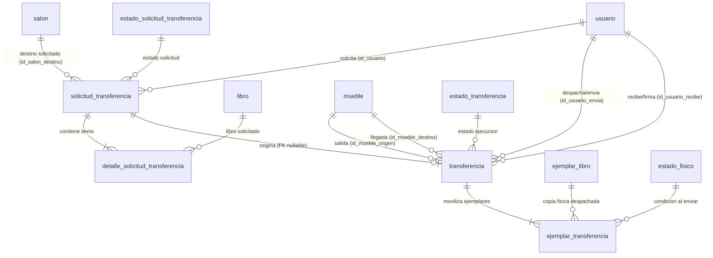

# Especificación y Diseño del Módulo de Transferencias — Arrupeteca

Documento técnico de diseño de base de datos, reglas de negocio y estándares arquitectónicos para el **Módulo de Transferencias de Ejemplares y Libros** del sistema **Arrupeteca**.

---

## 1. Reglas de Arquitectura y Estándares del Proyecto

Para mantener coherencia estricta con la arquitectura ya implementada en el sistema Arrupeteca (`Autor`, `Libro`, `ObraAutor`, `EjemplarLibro`, `Auditable`), este módulo respeta los siguientes principios:

### A. Claves Primarias y Restricciones (Patrón `ObraAutor`)
- **No utilizar claves primarias compuestas** (`@EmbeddedId` / `@IdClass`).
- Cada tabla, incluidas las de detalle (`detalle_solicitud_transferencia`, `ejemplar_transferencia`), posee su propio identificador único simple autoincremental:
  ```java
  @Id
  @GeneratedValue(strategy = GenerationType.IDENTITY)
  private Long id;
  ```
- Para evitar duplicidad física (ej. agregar el mismo ejemplar dos veces en la misma transferencia), se aplican restricciones de unicidad a nivel de tabla:
  ```java
  @Table(name = "ejemplar_transferencia", uniqueConstraints = {
      @UniqueConstraint(name = "uk_transferencia_ejemplar", columnNames = {"id_transferencia", "id_ejemplar_libro"})
  })
  ```

### B. Soft Delete (Borrado Lógico)
- Toda tabla transaccional y catálogo contiene la columna `borrado_logico TINYINT NOT NULL DEFAULT 0`.
- En JPA se anota con:
  ```java
  @SQLDelete(sql = "UPDATE nombre_tabla SET borrado_logico = 1 WHERE id = ?")
  ```

### C. Auditoría Automática (`Auditable`)
- Las entidades transaccionales principales (`SolicitudTransferencia`, `Transferencia`) heredan de la base `Auditable`:
  - `fecha_creacion DATETIME NOT NULL` (`@CreatedDate`)
  - `fecha_actualizacion DATETIME NOT NULL` (`@LastModifiedDate`)
  - `creado_por VARCHAR(100) NOT NULL` (`@CreatedBy`)
  - `actualizado_por VARCHAR(100) NULL` (`@LastModifiedBy`)

### D. Concurrencia Optimista (`@Version`)
- Entidades transaccionales de alto impacto de actualización de inventario (`Transferencia`) incluyen `@Version private Long version` para prevenir colisiones cuando múltiples procesos intentan actualizar el estado del envío o inventario simultáneamente.
- **Nota**: Las clases de auditoría (`Auditable`) se enfocan en trazabilidad de usuarios/fechas, mientras que `@Version` se define individualmente en entidades de estado transaccional.

### E. DTOs y Mappers
- DTOs definidos como **Java Records inmutables** organizados en:
  - `dto.request` (con validaciones de Bean Validation `@NotNull`, `@Min`, `@Size`).
  - `dto.response.detail` (detalle completo con relaciones expandidas).
  - `dto.response.summary` (proyecciones ligeras para tablas y paginación).
- Mapeos automáticos bidireccionales mediante **MapStruct** (`CentralMapperConfig`).

---

## 2. Tablas Catálogo de Estados

Los ciclos de vida de las solicitudes y las transferencias físicas se gestionan de forma desacoplada mediante catálogos maestros:

### 2.1. `estado_solicitud_transferencia` (Estado del Pedido / Intención)
Representa la fase administrativa del requerimiento hecho por un docente, estudiante o bibliotecario.

| Campo | Tipo | Nulo | Descripción |
| :--- | :--- | :--- | :--- |
| `id_estado_solicitud_transferencia` | BIGINT AUTO_INCREMENT | NO (PK) | Identificador del catálogo |
| `nombre` | VARCHAR(50) | NO | Nombre único del estado |
| `borrado_logico` | TINYINT | NO (DEF 0) | Eliminación lógica |

**Valores Semilla:**
1. `PENDIENTE` — Solicitud registrada, a la espera de revisión por el personal de biblioteca.
2. `APROBADA` — Solicitud validada; disponible para que el personal prepare el envío físico.
3. `RECHAZADA` — Solicitud denegada (registrando el `motivo_rechazo`).
4. `EN_PROCESO` — Se ha iniciado la transferencia física de los ejemplares.
5. `FINALIZADA` — Todos los libros solicitados fueron transferidos y recibidos exitosamente.

---

### 2.2. `estado_transferencia` (Estado de la Ejecución Física)
Representa la situación del traslado de los ejemplares físicos entre ubicaciones.

| Campo | Tipo | Nulo | Descripción |
| :--- | :--- | :--- | :--- |
| `id_estado_transferencia` | BIGINT AUTO_INCREMENT | NO (PK) | Identificador del catálogo |
| `nombre` | VARCHAR(50) | NO | Nombre único del estado |
| `borrado_logico` | TINYINT | NO (DEF 0) | Eliminación lógica |

**Valores Semilla:**
1. `EN_TRANSITO` — Los libros salieron del mueble origen y están en camino al destino.
2. `COMPLETADA` — Los libros llegaron al mueble destino y fueron confirmados por el receptor.
3. `CANCELADA` — El traslado fue abortado antes de ser entregado.
4. `CON_OBSERVACIONES` — Se completó la recepción pero con incidencias (ej. faltantes o daños en traslado).

---

## 3. Modelo Entidad-Relación



---

## 4. Desglose Detallado de Tablas

### 4.1. `solicitud_transferencia` (Cabecera de Solicitud)
Registra la petición formal de traslado de ejemplares hacia un salón.

```sql
CREATE TABLE solicitud_transferencia (
    id_solicitud_transferencia BIGINT AUTO_INCREMENT PRIMARY KEY,
    id_usuario BIGINT NOT NULL,
    id_salon_destino BIGINT NOT NULL,
    id_estado_solicitud_transferencia BIGINT NOT NULL,
    motivo VARCHAR(255) NULL,
    motivo_rechazo VARCHAR(255) NULL,
    borrado_logico TINYINT NOT NULL DEFAULT 0,
    creado_por VARCHAR(100) NOT NULL,
    fecha_creacion DATETIME NOT NULL,
    actualizado_por VARCHAR(100) NULL,
    fecha_actualizacion DATETIME NOT NULL,
    CONSTRAINT fk_sol_trans_usuario FOREIGN KEY (id_usuario) REFERENCES usuario(id_usuario),
    CONSTRAINT fk_sol_trans_salon FOREIGN KEY (id_salon_destino) REFERENCES salon(id_salon),
    CONSTRAINT fk_sol_trans_estado FOREIGN KEY (id_estado_solicitud_transferencia) REFERENCES estado_solicitud_transferencia(id_estado_solicitud_transferencia)
);
```

### 4.2. `detalle_solicitud_transferencia` (Libros Solicitados)
Permite solicitar **múltiples libros diferentes y sus cantidades** dentro de una sola solicitud.

```sql
CREATE TABLE detalle_solicitud_transferencia (
    id_detalle_solicitud_transferencia BIGINT AUTO_INCREMENT PRIMARY KEY,
    id_solicitud_transferencia BIGINT NOT NULL,
    id_libro BIGINT NOT NULL,
    cantidad INT NOT NULL,
    CONSTRAINT uk_solicitud_libro UNIQUE (id_solicitud_transferencia, id_libro),
    CONSTRAINT fk_det_sol_trans_cabecera FOREIGN KEY (id_solicitud_transferencia) REFERENCES solicitud_transferencia(id_solicitud_transferencia),
    CONSTRAINT fk_det_sol_trans_libro FOREIGN KEY (id_libro) REFERENCES libro(id_libro)
);
```

### 4.3. `transferencia` (Cabecera de Ejecución Física)
Registra la acción física de traslado entre muebles, con control de envío y firma de recepción.

```sql
CREATE TABLE transferencia (
    id_transferencia BIGINT AUTO_INCREMENT PRIMARY KEY,
    id_solicitud_transferencia BIGINT NULL,
    id_usuario_envia BIGINT NOT NULL,
    id_usuario_recibe BIGINT NULL,
    id_mueble_origen BIGINT NOT NULL,
    id_mueble_destino BIGINT NOT NULL,
    id_estado_transferencia BIGINT NOT NULL,
    fecha_envio DATETIME NOT NULL,
    fecha_recepcion DATETIME NULL,
    observacion_recepcion VARCHAR(255) NULL,
    confirmada TINYINT NOT NULL DEFAULT 0,
    motivo VARCHAR(255) NULL,
    version BIGINT NOT NULL DEFAULT 0,
    borrado_logico TINYINT NOT NULL DEFAULT 0,
    creado_por VARCHAR(100) NOT NULL,
    fecha_creacion DATETIME NOT NULL,
    actualizado_por VARCHAR(100) NULL,
    fecha_actualizacion DATETIME NOT NULL,
    CONSTRAINT fk_trans_solicitud FOREIGN KEY (id_solicitud_transferencia) REFERENCES solicitud_transferencia(id_solicitud_transferencia),
    CONSTRAINT fk_trans_usr_envia FOREIGN KEY (id_usuario_envia) REFERENCES usuario(id_usuario),
    CONSTRAINT fk_trans_usr_recibe FOREIGN KEY (id_usuario_recibe) REFERENCES usuario(id_usuario),
    CONSTRAINT fk_trans_mueble_orig FOREIGN KEY (id_mueble_origen) REFERENCES mueble(id_mueble),
    CONSTRAINT fk_trans_mueble_dest FOREIGN KEY (id_mueble_destino) REFERENCES mueble(id_mueble),
    CONSTRAINT fk_trans_estado FOREIGN KEY (id_estado_transferencia) REFERENCES estado_transferencia(id_estado_transferencia)
);
```

### 4.4. `ejemplar_transferencia` (Detalle de Copias Físicas Movidada)
Registra cada copia física despachada y valida su recepción individual.

```sql
CREATE TABLE ejemplar_transferencia (
    id_ejemplar_transferencia BIGINT AUTO_INCREMENT PRIMARY KEY,
    id_transferencia BIGINT NOT NULL,
    id_ejemplar_libro BIGINT NOT NULL,
    id_estado_fisico_al_momento BIGINT NOT NULL,
    recibido TINYINT NOT NULL DEFAULT 0,
    CONSTRAINT uk_transferencia_ejemplar UNIQUE (id_transferencia, id_ejemplar_libro),
    CONSTRAINT fk_ejem_trans_cabecera FOREIGN KEY (id_transferencia) REFERENCES transferencia(id_transferencia),
    CONSTRAINT fk_ejem_trans_ejemplar FOREIGN KEY (id_ejemplar_libro) REFERENCES ejemplar_libro(id_ejemplar_libro),
    CONSTRAINT fk_ejem_trans_est_fisico FOREIGN KEY (id_estado_fisico_al_momento) REFERENCES estado_fisico(id_estado_fisico)
);
```

---

## 5. Flujo Operativo y Reglas de Negocio

### Paso 1: Solicitud Multi-Libro
- Un usuario registra una `solicitud_transferencia` hacia un `id_salon_destino`.
- Agrega 1 o N registros en `detalle_solicitud_transferencia` especificando libros y cantidades pedidas (ej. 10 de *Libro A* y 5 de *Libro B*).

### Paso 2: Aprobación o Rechazo
- Si se aprueba: Pasa a estado `APROBADA`.
- Si se rechaza: Pasa a estado `RECHAZADA` y se completa `motivo_rechazo` explícitamente.

### Paso 3: Despacho y Envío
- El encargado selecciona los ejemplares físicos concretos desde un `id_mueble_origen`.
- Se crea la `transferencia` en estado `EN_TRANSITO`, registrando `id_usuario_envia`, `id_mueble_destino` exacto y la lista de ejemplares en `ejemplar_transferencia`.

### Paso 4: Recepción y Firma
- Al recibir la carga en el destino, el receptor revisa los libros, marca `recibido = 1` en cada ejemplar entregado de forma conforme.
- El receptor firma/confirma actualizando `confirmada = 1`, `id_usuario_recibe`, `fecha_recepcion` y opcionalmente `observacion_recepcion`.
- El sistema actualiza automáticamente la ubicación del inventario (`id_mueble = id_mueble_destino`) en la tabla `ejemplar_libro`.
