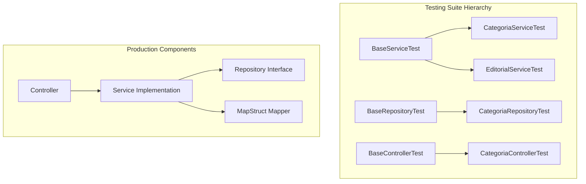

# Implementation Plan (Plan de Implementación) - Catalog Testing (Pruebas de Catálogo)

## Summary (Resumen)
| Field | Value |
|-------|-------|
| Feature | Catalog Testing & Standardization |
| Branch | Refactorizacion |
| Spec Maturity | clarified |

## Technical Context (Contexto Técnico)
| Field | Value |
|-------|-------|
| Language/Version | Java 21 |
| Primary Dependencies | Spring Boot 4.0.2, JPA, Hibernate, MapStruct |
| Storage | H2 (Tests), MySQL (Dev/Prod) |
| Testing | JUnit 5, Mockito, AssertJ, MockMvc |
| Project Type | web |
| Project Mode | brownfield |

## Architecture Decisions (Decisiones Arquitectónicas)
| ID | Question | Options | Choice | Rationale |
|----|----------|---------|--------|-----------|
| AD-001 | ¿Cómo reducir duplicación en tests de catálogos? | Individuales, Clases Base | **Clases Base** | Los 9 catálogos comparten el patrón base de catálogo (ID, nombre, borrado lógico), permitiendo una base común extendible para Editorial. |
| AD-002 | ¿Qué motor de persistencia usar para tests? | H2, Testcontainers | **H2** | Velocidad de ejecución y suficiencia para CRUD simple. |
| AD-003 | ¿Cómo manejar las inconsistencias de paginación? | Mantener, Estandarizar | **Estandarizar a Page<T>** | Consistencia con Editorial y preparación para escalabilidad. |
| AD-004 | ¿Qué excepción usar para errores de negocio? | RuntimeException, ValidacionNegocioException | **ValidacionNegocioException** | Permite manejo centralizado y respuestas estandarizadas. |

## Architecture (Arquitectura)

## Data Model Summary (Resumen del Modelo de Datos)
N/A — no persistent data changes (using existing entities).

## API Surface Summary (Resumen de la Superficie de la API)
| Method | Endpoint | Description |
|--------|----------|-------------|
| GET | `/api/v1/{recurso}` | Ahora retorna `Page<T>` (antes `List<T>`). |
| GET | `/api/v1/{recurso}/admin` | Ahora retorna `Page<T>` (antes `List<T>`). |

## Source Code Structure (Estructura del Código Fuente)
~ arrupeteca/src/main/java/com/arrupeteca/service/impl/ (Refactorización para paginación y excepciones)
~ arrupeteca/src/main/java/com/arrupeteca/controller/ (Refactorización para Page<T> en API)
~ arrupeteca/src/main/java/com/arrupeteca/persistence/repository/ (Actualización de firmas de métodos)
+ arrupeteca/src/test/java/com/arrupeteca/persistence/entity/ (Tests de Entidad)
+ arrupeteca/src/test/java/com/arrupeteca/persistence/repository/ (Tests de Repositorio)
+ arrupeteca/src/test/java/com/arrupeteca/service/impl/ (Tests de Servicio)
+ arrupeteca/src/test/java/com/arrupeteca/controller/ (Tests de Controlador)

## Testing Strategy (Estrategia de Pruebas)
| Tier | Tool | Scope | Mock Boundary | Install |
|------|------|-------|---------------|---------|
| Unit | JUnit 5 / Mockito | Business Logic / Entity Validations | Repository / Mapper | configured |
| Integration | Spring Data JPA / H2 | Repository Custom Queries | N/A (In-memory DB) | configured |
| Web Integration | MockMvc | API Contracts / Response Formatting | Service | configured |

## Error Handling Strategy (Estrategia de Manejo de Errores)
| Error Category | Pattern | Response | Retry |
|----------------|---------|----------|-------|
| Validation | Fail-fast | 400 Bad Request + ApiResponse | no |
| Business Logic | Fail-fast | 409 Conflict / 404 Not Found + ValidacionNegocioException | no |

## Risk Mitigation (Mitigación de Riesgos)
| Risk | Mitigation | Owner |
|------|------------|-------|
| H2 incompatibilidad con MySQL | Uso exclusivo de consultas JPA/JPQL estándar. | Repository Layer |
| Rompimiento de contrato API | Mantener estructura `ApiResponse` intacta. | Controller Layer |

## Requirement Coverage Map (Mapa de Cobertura de Requerimientos)
| ID | Requirement | Implementation Component | File Path |
|----|-------------|-------------------------|-----------|
| TR-001 | Pruebas de unidad para entidades | JUnit 5 Entity Tests | `src/test/java/com/arrupeteca/persistence/entity/*` |
| TR-002 | Pruebas de persistencia con H2 | DataJpaTest Repositories | `src/test/java/com/arrupeteca/persistence/repository/*` |
| TR-003 | Pruebas de servicio con Mockito | JUnit 5 Service Tests | `src/test/java/com/arrupeteca/service/impl/*` |
| TR-004 | Estandarización de Page<T> | Service & Controller Layer | `src/main/java/com/arrupeteca/*` |
| TR-005 | Ubicación en src/test/java | Project Layout | `arrupeteca/src/test/java/...` |
| TR-006 | Validación de ApiResponse | Controller Tests | `src/test/java/com/arrupeteca/controller/*` |

## Implementation Hints (Sugerencias de Implementación)
- **[HINT-001]** Order: Refactorizar primero las firmas de Repositorio, luego Service y finalmente Controller.
- **[HINT-002]** Gotcha: `Editorial` tiene campos extra; asegurar que `BaseServiceTest` sea lo suficientemente genérica o extensible.
- **[HINT-003]** Constraint: Mantener el 100% de cobertura según las instrucciones del proyecto.
- **[HINT-004]** Performance: Usar perfiles de Spring `@ActiveProfiles("test")` para cargar configuración de H2.
- **[HINT-005]** Pattern: Usar `@Mock` para dependencias y `@InjectMocks` para la clase a probar en servicios.
- **[HINT-006]** Skill: Utilizar la skill `context7-mcp` para obtener referencias precisas de las APIs de Spring Boot 4.x y bibliotecas de testing durante la implementación.

## Compliance Check (Control de Cumplimiento)
- [ ] TDD Mandatory: El plan define suites de pruebas exhaustivas antes de completar la refactorización.
- [ ] Simplicity: El uso de clases base evita duplicación innecesaria para los 9 catálogos.
- [ ] Language Policy: Headers en Inglés, Contenido en Español.
