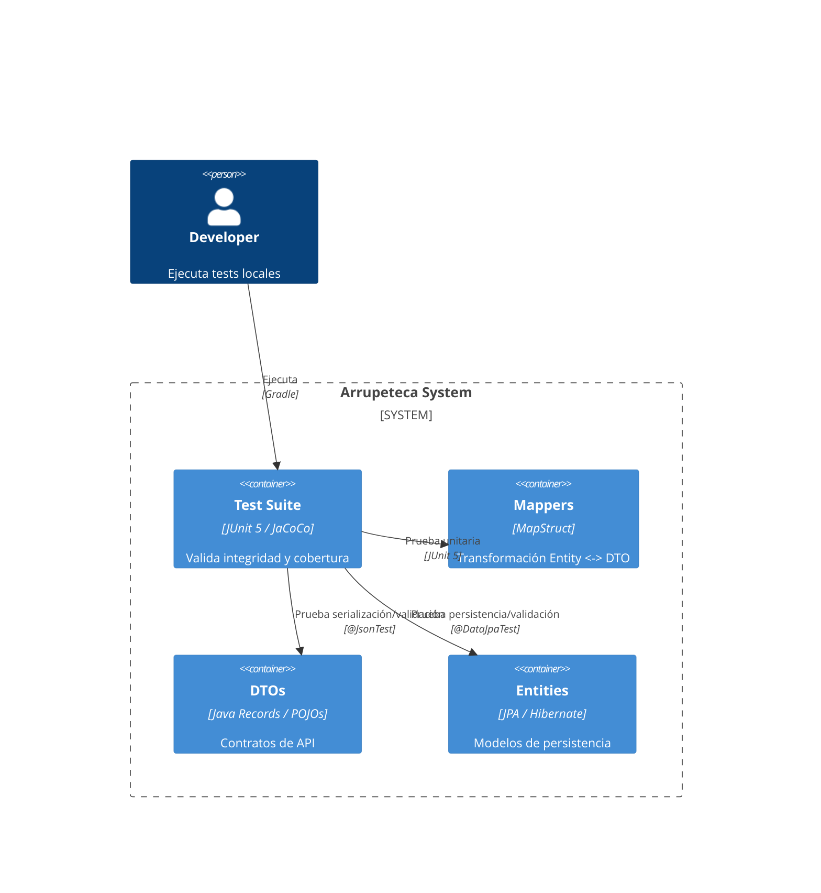

# Implementation Plan: Comprehensive Test Coverage (Cobertura de Pruebas Integral)

**Branch**: `Refactorizacion` | **Date**: 2026-04-12 | **Spec**: `governance/specs/00002-comprehensive-test-coverage/spec.md`

## Summary

**Goal**: Alcanzar una cobertura de pruebas del 100% real eliminando exclusiones de JaCoCo en Mappers, DTOs y configuraciones mediante la implementación de pruebas unitarias y de serialización.  
**Approach**: Implementación de pruebas unitarias JUnit 5 para Mappers (MapStruct) sin contexto de Spring, pruebas `@JsonTest` con validación de Bean Validation para DTOs, y configuración de JaCoCo para excluir solo código generado automáticamente.  
**Key Constraint**: Mantener la velocidad de la suite de pruebas evitando la carga innecesaria del contexto de Spring en pruebas unitarias de mappers.

## Technical Context

**Language/Version**: Java 21  
**Primary Dependencies**: Spring Boot 3.4.2 (actual), MapStruct 1.6.2, JUnit 5, AssertJ, Mockito  
**Storage**: H2 (para pruebas de persistencia residuales)  
**Testing**: JUnit 5 / Spring Boot Test / JaCoCo  
**Target Platform**: Linux (Gradle)  
**Project Type**: web  
**Project Mode**: brownfield  
**Performance Goals**: Suite de pruebas unitarias < 30s  
**Constraints**: 100% de cobertura en paquetes de lógica y contratos  
**Scale/Scope**: ~25 nuevas clases de prueba para cubrir 7 mappers y 17+ DTOs

## Instructions Check

*GATE: Must pass before Phase 0 research. Re-check after Phase 1 design.*

- [X] TDD Mandatory: Se diseñan los tests para cubrir código existente sin pruebas.
- [X] Language Policy: Headers en Inglés, Contenido en Español.
- [X] Governance: Archivo ubicado en `governance/specs/00002-comprehensive-test-coverage/`.

## Architecture



## Architecture Decisions

| ID | Decision | Options Considered | Chosen | Rationale |
|----|----------|--------------------|--------|-----------|
| AD-001 | Ubicación de Tests | __tests__ vs src/test/java | src/test/java | Estándar de Gradle y compatibilidad con IDEs. |
| AD-002 | Estrategia Mappers | @SpringBootTest vs Mappers.getMapper | Plain JUnit 5 | Rendimiento; MapStruct genera código Java puro que no requiere Spring para ser probado. |
| AD-003 | Exclusión JaCoCo | Excluir paquetes vs Excluir anotados | @Generated + Excl. Manual | Permite medir la cobertura real del código escrito a mano mientras se ignora el código generado (boilerplate). |
| AD-004 | Validación DTOs | Solo serialización vs Jackson + Bean Validation | Jackson + Bean Validation | Asegura que el contrato de la API no solo sea estructuralmente correcto sino que las restricciones de negocio se cumplan. |

## Data Model Summary

N/A — no persistent data (Solo se añade cobertura para `ObraAutor` existente).

## API Surface Summary

N/A — no API surface (Solo se añade cobertura para `ApiResponse` y DTOs existentes).

## Testing Strategy

| Tier | Tool | Scope | Mock Boundary | Install |
|------|------|-------|---------------|---------|
| Unit | JUnit 5 / AssertJ | Mappers (MapStruct) | Dependencies (via Mockito) | configured |
| Serialization | @JsonTest / Jackson | DTOs (Requests) | N/A | configured |
| Validation | Jakarta Validator | Bean Validation (@NotBlank, etc) | N/A | configured |
| Persistence | @DataJpaTest / H2 | Entities (ObraAutor) | N/A | configured |
| Coverage | JaCoCo | Todo el código fuente | — | configured |

## Error Handling Strategy

| Error Category | Pattern | Response | Retry |
|----------------|---------|----------|-------|
| Validation | Fail-fast | 400 Bad Request | no |
| Test Failure | Halt build | Gradle exit code 1 | no |

## Integration Points

| Spec Reference | System/Service | Technical Approach | Contract |
|----------------|----------------|--------------------|----------|
| IP-001 | MapStruct | Inyección de dependencias manual en tests unitarios para mappers complejos. | interfaces de mappers |
| IP-002 | Jackson | Uso de `JacksonTester` para validar serialización bidireccional. | @JsonTest |

## Risk Mitigation

| Risk (from spec) | Likelihood | Impact | Mitigation | Owner |
|-------------------|------------|--------|------------|-------|
| Dificultad instanciando proyecciones | Medium | Medium | Usar interfaces proxy de Mockito para simular comportamientos de proyecciones en tests de mappers. | Architect |
| Regresiones en build por cobertura | High | Low | Eliminar exclusiones de JaCoCo gradualmente por paquete conforme se implementan los tests. | Architect |

## Requirement Coverage Map

| Req ID | Component(s) | File Path(s) | Notes |
|--------|--------------|--------------|-------|
| TR-001 | MapStruct Mappers | `src/test/java/com/arrupeteca/mapper/*` | Pruebas unitarias puras. |
| TR-002 | Request DTOs | `src/test/java/com/arrupeteca/dto/request/*` | @JsonTest + Validator. |
| TR-003 | Response Structure | `src/test/java/com/arrupeteca/dto/response/ApiResponseTest.java` | Validación de genéricos y serialización. |
| TR-004 | Test Naming | N/A | Convención obligatoria [ClassName]Test. |
| TR-005 | Persistence Gaps | `src/test/java/com/arrupeteca/persistence/entity/ObraAutorTest.java` | @DataJpaTest. |
| TR-006 | Gradle Standard | Project Structure | Uso de src/test/java. |

## Project Structure

### Source Code

```text
arrupeteca/
  build.gradle (~)
  src/
    test/java/com/arrupeteca/
      + config/JpaConfigTest.java
      + dto/
        + response/ApiResponseTest.java
        + request/ (cobertura para las 17 clases de request)
      + mapper/
        + EdificioMapperTest.java
        + LibroMapperTest.java
        + MuebleMapperTest.java
        + ObraMapperTest.java
        + PlantaMapperTest.java
        + SalonMapperTest.java
        + EjemplarLibroMapperTest.java
      + persistence/entity/
        + ObraAutorTest.java
```

**Brownfield Notes**:
**Patterns to reuse**: Uso de `BaseControllerTest` y `BaseServiceTest` si aplica, aunque la mayoría de los nuevos tests son de nivel unitario o `@JsonTest`.
**Tests to extend**: Ampliar el reporte de cobertura eliminando los bloques `excludes` en `jacocoTestCoverageVerification` del `build.gradle`.
**Naming conventions**: Seguir estrictamente el sufijo `Test` para todas las clases de prueba.

## Implementation Hints

- **[HINT-001]** Gradle: Para excluir código generado en JaCoCo, configurar MapStruct con `-Amapstruct.addGeneratedAnnotation=true` en `build.gradle`.
- **[HINT-002]** Performance: Los tests de mappers NO deben usar `@ExtendWith(SpringExtension.class)` a menos que sea estrictamente necesario por dependencias circulares.
- **[HINT-003]** DTOs: En `@JsonTest`, usar `@Import(ValidationAutoConfiguration.class)` para habilitar el `Validator` de Spring.
- **[HINT-004]** Coverage: Al eliminar exclusiones en `build.gradle`, hacerlo clase por clase para no romper el CI de inmediato.
- **[HINT-005]** Mockito: Usar `Mockito.mock(ClassResumen.class)` para probar mappers que reciben proyecciones.
- **[HINT-006]** Skill: Utilizar la skill `context7-mcp` para obtener referencias precisas y documentación reciente de las APIs de Spring Boot 3.4+, MapStruct 1.6+ y bibliotecas de testing durante la implementación.

## Compliance Check (Control de Cumplimiento)

### Instructions Check Report (Reporte de Verificación de Instrucciones)
**Target (Objetivo)**: plan.md
**Status (Estado)**: PASS

| Principle (Principio) | Verdict (Veredicto) | Notes (Notas) |
|-----------|---------|-------|
| Test-First | PASS | El plan se enfoca exclusivamente en la creación de suites de pruebas. |
| Simplicity | PASS | Uso de tests unitarios ligeros y @JsonTest para evitar sobrecarga. |
| Agent Output Style | PASS | Formato conciso siguiendo la plantilla de SDD Pilot. |
| Language Policy | PASS | Encabezados bilingües y contenido en Español. |
| Governance | PASS | Ubicación correcta en carpeta governance/specs/. |
| Tech Stack | PASS | Alineado con Java 21 y Spring Boot 3.4.2 (detectado en build.gradle). |
