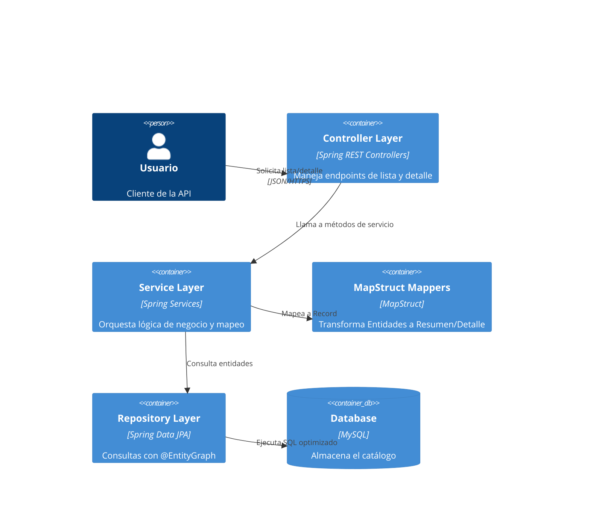

# Implementation Plan: Patrón Resumen vs Detalle y Optimización JPA

**Branch**: `00004-resumen-vs-detalle` | **Date**: 2026-04-24 | **Spec**: `governance/specs/00004-resumen-vs-detalle/spec.md`

## Summary

**Goal**: Implementar el patrón de respuesta diferenciada (Resumen/Detalle) para optimizar el rendimiento de la API y corregir errores de mapeo existentes.  
**Approach**: Migrar proyecciones SpEL a Java Records (Summary) y Java Records  (Detail) usando MapStruct, optimizando las consultas con `@EntityGraph`.  
**Key Constraint**: Mantener latencia de procesamiento <100ms para listados de 50 ítems.

## Technical Context

**Language/Version**: Java 21  
**Primary Dependencies**: Spring Boot 3.4.2, MapStruct 1.6.3, Lombok, Spring Data JPA  
**Storage**: MySQL 8.x  
**Testing**: JUnit 5, Mockito, AssertJ  
**Target Platform**: Local (Gradle)  
**Project Type**: web  
**Project Mode**: brownfield  
**Performance Goals**: <100ms p95 para listados paginados  
**Constraints**: Zero SpEL in response layer, 100% test coverage  
**Scale/Scope**: 13 Entidades Nucleares, 3 Entidades Maestras

## Instructions Check

*GATE: Must pass before Phase 0 research. Re-check after Phase 1 design.*

- **Language Policy**: PASSED. Headers bilingual, content in Spanish.
- **TDD Mandatory**: PASSED. Unit tests for Mappers and DTOs included in scope.
- **Size Budget**: PASSED. Plan targeted to be <10KB.
- **Type Safety**: PASSED. Replacing SpEL/Interface projections with typed Records/Classes.

## Architecture



## Architecture Decisions

| ID | Decision | Options Considered | Chosen | Rationale |
|----|----------|--------------------|--------|-----------|
| AD-001 | Estructura de Resumen | Interface Projection / Java Record | Java Record | Inmutabilidad, mejor rendimiento que proyecciones dinámicas y mayor seguridad de tipos sin SpEL. |
| AD-002 | Manejo de Ciclos | @JsonManagedReference / MapStruct Unidireccional | MapStruct Unidireccional | Evita el acoplamiento a anotaciones de Jackson en el modelo y permite control total en el mapeo. |
| AD-003 | Ubicación de DTOs | persistence.projection / dto.response | dto.response.[summary/detail] | Sigue el estándar de separación de capas; persistence solo debe contener lógica de BD. |
| AD-004 | Definición EntityGraph | NamedEntityGraph / @EntityGraph dinámico | @EntityGraph dinámico | Mayor flexibilidad en los repositorios sin ensuciar las clases @Entity. Las colecciones en vistas de detalle (OneToMany/ManyToMany) confiarán en el batch_fetch_size=100 global para optimizar la carga perezosa. |

## Data Model Summary

N/A — no persistent data (Solo se modifican las capas de respuesta y acceso, no el esquema de base de datos).

## API Surface Summary

| Method | Path | Purpose | Auth | Req/Res Types |
|--------|------|---------|------|---------------|
| GET | `/api/v1/[recurso]` | Listado paginado | N/A | `Page<[Entidad]Resumen>` |
| GET | `/api/v1/[recurso]/{id}` | Detalle completo | N/A | `[Entidad]DetalleResponse` |

## Testing Strategy

| Tier | Tool | Scope | Mock Boundary | Install |
|------|------|-------|---------------|---------|
| Unit | JUnit 5 | Mappers y DTOs | Sin contexto de Spring | configured |
| Integration | MockMvc | Endpoints (Lista vs Detalle) | Repositorios (Mocked) | configured |
| Security | Checkstyle | Estilo y reglas de oro | — | configured |
| Coverage | JaCoCo | Cobertura de lógica de mapeo | — | configured |

## Error Handling Strategy

| Error Category | Pattern | Response | Retry |
|----------------|---------|----------|-------|
| Not Found | Fail-fast | 404 + GlobalExceptionHandler | no |
| Mapping Error | Fail-fast | 500 + Log SLF4J | no |

## Integration Points

| Spec Reference | System/Service | Technical Approach | Contract |
|----------------|----------------|--------------------|----------|
| IP-001 | Controllers | Inyección de Mappers centralizados | `/api/v1/*` |

## Risk Mitigation

| Risk (from spec) | Likelihood | Impact | Mitigation | Owner |
|-------------------|------------|--------|------------|-------|
| Recursion (Ciclos JSON) | Low | High | MapStruct configurado para ignorar relaciones inversas en DetalleResponse. | Mapper |
| Breaking Changes | Medium | High | Mantener nombres de campos existentes en Records de Resumen donde sea posible. | Controller |

## Requirement Coverage Map

| Req ID | Component(s) | File Path(s) | Notes |
|--------|--------------|--------------|-------|
| TR-001 | Record | `+ com.arrupeteca.dto.response.detail.*` | Implementación de DetalleResponse. |
| TR-002 | Record | `+ com.arrupeteca.dto.response.summary.*` | Reemplazo de proyecciones SpEL por Records. |
| TR-003 | Mapper | `~ com.arrupeteca.mapper.*` | Lógica de ubicación en `default` methods (solo Detalle). |
| TR-004 | Repository | `~ com.arrupeteca.persistence.repository.*` | Inclusión de `@EntityGraph(attributePaths = ...)` |
| TR-005 | Projection/Record | `+ com.arrupeteca.dto.response.summary.EjemplarLibroResumen` | Corrección: `codigoInventario` -> `comentario`. |

## Project Structure

### Source Code

```text
arrupeteca/src/main/java/com/arrupeteca/
├── dto/
│   └── response/
│       ├── + summary/ (Java Records para listas)
│       └── + detail/ (Java Records para detalles)
├── mapper/
│   └── ~ [Entidad]Mapper.java (Lógica de ubicación y unidireccionalidad)
└── persistence/
    └── repository/
        └── ~ [Entidad]Repository.java (@EntityGraph dinámico)
```

**Patterns to reuse (Patrones a reutilizar)**: Layered Architecture, MapStruct component model "spring".  
**Tests to extend (Pruebas a extender)**: `com.arrupeteca.controller.*Test`, `com.arrupeteca.mapper.*Test`.  
**Naming conventions (Convenciones de nombres)**: `[Entidad]Resumen` y `[Entidad]DetalleResponse` (ambos Java Records).

## Implementation Hints (Consejos de Implementación)

- **[HINT-001]** Order: Implementar primero los Records de `summary` para estabilizar los listados antes de crear los `detail`.
- **[HINT-002]** Gotcha: Al usar Records en MapStruct, asegúrate de que los nombres de los componentes del Record coincidan con los de la entidad o usa `@Mapping`.
- **[HINT-003]** Performance: Verifica que `@EntityGraph` incluya solo relaciones `ManyToOne`/`OneToOne` en el `Resumen` para evitar Joins innecesarios.
- **[HINT-004]** Order: Actualizar los métodos del Repository antes que el Service para que el autocompletado detecte los nuevos tipos.

## Compliance Check (Control de Cumplimiento)

- **TDD Mandatory (TDD Obligatorio)**: PASSED. El plan especifica pruebas unitarias para Mappers y DTOs, además de pruebas MockMvc para validar el cambio en los endpoints.
- **Language Policy (Política de Idioma)**: PASSED. Contenido en español y encabezados bilingües siguiendo el patrón English Title (Título en Español).
- **Size Budget (Presupuesto de Tamaño)**: PASSED. El archivo se mantiene bajo el límite de 10 KB.
- **Technology Stack (Stack Tecnológico)**: PASSED. Uso de Java 21 (Records), Spring Boot 3.4.2 y MapStruct alineado con el SAD.
- **Source Code Layout (Disposición del Código Fuente)**: PASSED. Respeta `ENFORCE_SRC_ROOT` y la estructura de paquetes existente.
- **Agent Output Style (Estilo de Salida del Agente)**: PASSED. Formato orientado a agentes con tablas y listas etiquetadas, sin narrativa redundante.
